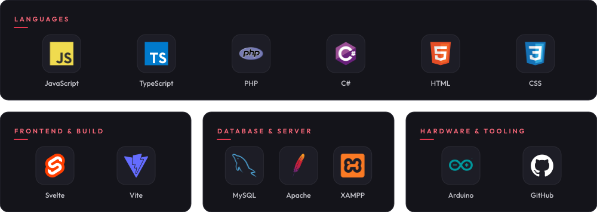
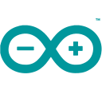
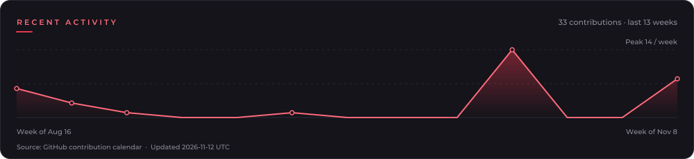



<h3>Building web applications, software testing tools, and Arduino-based systems.</h3>

  4th Year BS Information Technology Student · Quezon City University 
  Quezon City, Philippines

  <a href="https://github.com/jeondanel?tab=repositories"><b>Repositories</b></a>
  &nbsp;·&nbsp;
  <a href="https://github.com/jeondanel/jeondanel.github.io">&nbsp;<b>Portfolio</b></a>

  <a href="#about">About</a> ·
  <a href="#tech-stack">Tech Stack</a> ·
  <a href="#featured-projects">Projects</a> ·
  <a href="#github-statistics">Statistics</a>

---

## About

I'm **Danel Macuja Tungpalan**, a Bachelor of Science in Information Technology student at **Quezon City University**. My projects span web applications, software testing tools, and Arduino-based systems, from student enrollment workflows to sustainable water dispensing.

## Tech Stack

  

## Featured Projects

| Project | Description | Stack |
| :--- | :--- | :--- |
| [**EcoHydrate**](https://github.com/jeondanel/EcoHydrate-Arduino-Based-Smart-Water-Dispenser) | Exchanges inserted plastic bottles for timed water refills using sensors and automated dispensing. | &nbsp; |
| [**Enrollment & Registration**](https://github.com/jeondanel/Enrollment-and-Registration-Subsystem) | Centralizes student applications, subject selection, and registrar enrollment management. | &nbsp;&nbsp;&nbsp;&nbsp; |
| [**QATrail**](https://github.com/jeondanel/QATrail-Test-Case-and-Bug-Tracking-System) | Connects test cases, execution results, and bug tracking in one workflow. | Test management |
| [**Portfolio**](https://github.com/jeondanel/jeondanel.github.io) | A one-page portfolio with project, about, and contact sections. | &nbsp;&nbsp; |

## GitHub Statistics

  
  

  

Statistics are generated from the GitHub API and refreshed daily by a [GitHub Action](./.github/workflows/stats.yml), so they are always served from this repository. Language totals reflect repository code, not proficiency. <a href="https://github.com/jeondanel?tab=overview">View contributions directly →</a>

<!-- Add confirmed career goals, capstone designation, live portfolio URL, LinkedIn, and public email when available. -->
