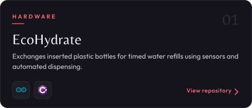
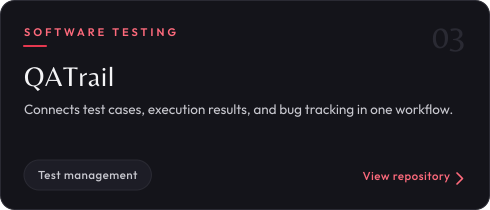
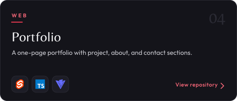
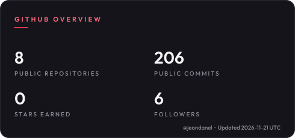
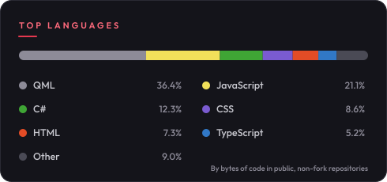



  4th Year BS Information Technology Student · Quezon City University 
  Quezon City, Philippines

  <a href="https://github.com/jeondanel?tab=repositories"><b>Repositories</b></a>
  &nbsp;·&nbsp;
  <a href="https://github.com/jeondanel/jeondanel.github.io">&nbsp;<b>Portfolio</b></a>

  <a href="#about">About</a> ·
  <a href="#tech-stack">Tech Stack</a> ·
  <a href="#featured-projects">Projects</a> ·
  <a href="#github-statistics">Statistics</a>

---

## About

I'm **Danel Macuja Tungpalan**, a Bachelor of Science in Information Technology student at **Quezon City University**. My projects span web applications, software testing tools, and Arduino-based systems, from student enrollment workflows to sustainable water dispensing.

## Tech Stack

  

## Featured Projects

  
  

  
  

## GitHub Statistics

  
  

  

Statistics are generated from the GitHub API and refreshed daily by a [GitHub Action](./.github/workflows/stats.yml), so they are always served from this repository. Language totals reflect repository code, not proficiency. <a href="https://github.com/jeondanel?tab=overview">View contributions directly →</a>

<!-- Add confirmed career goals, capstone designation, live portfolio URL, LinkedIn, and public email when available. -->
